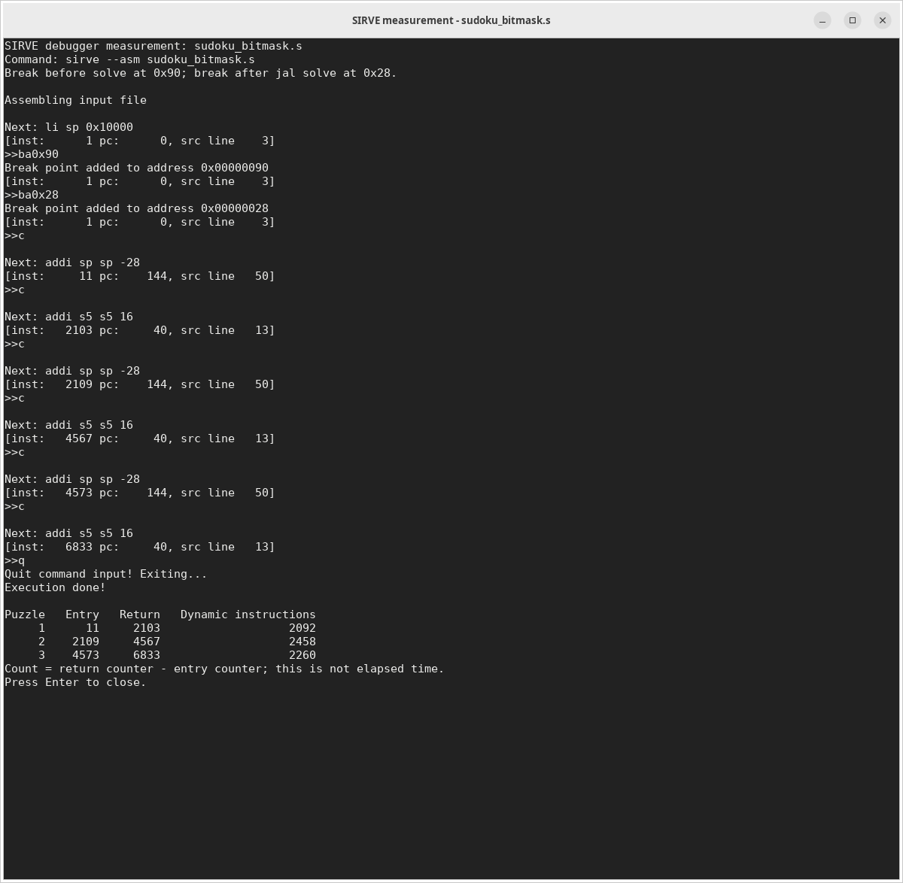

# RISC-V Sudoku Lab

4×4 Sudoku를 naked-single 규칙으로 푸는 RV32I 구현과 개선 전후 비교 자료.
빈칸과 후보 숫자를 오름차순으로 검사하고, 후보가 하나인 칸을 즉시 채운 뒤
한 번의 전체 순회에서 변화가 없으면 종료함.

## 자료 구성

| 파일 | 역할 |
|---|---|
| [sudoku_baseline.s](sudoku_baseline.s) | 보고서 (a)·(b)·(c)의 기준이 되는 개선 전 구현. 기존 `sudoku1.s`의 주석까지 보존한 복사본 |
| [sudoku_ideation.c](sudoku_ideation.c) | 같은 알고리즘을 읽기 쉬운 C로 정리한 설계 모델 |
| [sudoku_bitmask.s](sudoku_bitmask.s) | `solve`는 그대로 두고, `can_place`에 로컬 비트마스크·반복 펼치기·중복 검사 제거를 적용한 비교 구현 |
| [scripts/measure.py](scripts/measure.py) | 실제 SIRVE debugger의 PTY에 중단점 명령을 입력하고 카운터 차이를 계산 |
| [scripts/verify.py](scripts/verify.py) | 두 구현과 C 모델의 기능·호출 규약 검증 |
| [assets/](assets/) | 실제 터미널 캡처와 수정하지 않은 debugger 측정 로그 |

과제에서 제공한 caller, 입력 퍼즐, 정답 배열 및 checker는 두 assembly 파일 모두
유지함. solver와 helper는 정답 배열에 접근하지 않음.
원래 프로그램의 골격과 실행기는 [SeMinLim/sirve](https://github.com/SeMinLim/sirve)에서
제공한 것임. 측정한 SIRVE 소스 커밋:
[`ad5264469faac4344118f711f33e5032cf776e81`](https://github.com/SeMinLim/sirve/tree/ad5264469faac4344118f711f33e5032cf776e81).

## 개선 전후 instruction count

`solve`의 첫 명령 **직전**(PC `0x90`)과 caller의 `jal solve` 다음 명령
**직전**(PC `0x28`)에 중단점 설정. 아래 값은 두 `inst` 표시값의 차이.
helper 호출, prologue/epilogue, 마지막 `ret`을 포함하며 caller의 `jal`과 정답 검사는
포함하지 않음. 명령어 수는 실행 시간이나 CPU cycle 측정값이 아님.

| 퍼즐 | 개선 전 | 개선 후 | 감소한 명령어 수 | 감소율 |
|---|---:|---:|---:|---:|
| 1 | 3004 | 2092 | 912 | 30.36% |
| 2 | 3766 | 2458 | 1308 | 34.73% |
| 3 | 3355 | 2260 | 1095 | 32.64% |
| 합계 | 10125 | 6810 | 3315 | 32.74% |

두 구현 모두 supplied checker의 mismatch count는 `0, 0, 0`.
개선율은 제공된 세 퍼즐에서 측정한 결과이며 다른 입력에서 같다고 가정하지 않음.

### Before: baseline


[원본 debugger 로그](assets/sudoku_baseline-measurement.txt)

### After: bitmask



[원본 debugger 로그](assets/sudoku_bitmask-measurement.txt)

로컬 터미널에서 `scripts/measure.py`를 실행한 결과를 직접 캡처한 이미지.
측정 스크립트는 `pexpect`로 실제 SIRVE debugger의 PTY에 중단점 명령을 입력함.
직접 촬영한 PNG 원본을 그대로 첨부함.
각 캡처 하단의 요약 표는 같은 세션에서 얻은 카운터의 차이를 계산한 값.

## 비트마스크 구현에서 바뀐 점

1. 숫자 `d`를 `1 << d`로 표현하고, 행의 네 칸과 열의 네 칸에 대한 비트를 OR로
   합침. `used_mask & (1 << candidate)`가 0이면 그 그룹에 같은 숫자가 없음을 의미함.
   빈칸 0은 bit 0을 만들지만 후보는 1~4이므로 결과에 영향을 주지 않음.
2. 길이가 4로 고정된 행·열 검사를 펼쳐 반복문의 인덱스 갱신·종료 비교·점프를 줄임.
3. 같은 2×2 box의 네 칸 중 대상 칸과 같은 행·열의 칸은 이미 검사한 상태.
   남은 대각선 칸의 인덱스 `p ^ 5`만 추가 검사함. 이 식은 4×4 board 전용.

따라서 위 감소율은 **비트마스크 하나만의 효과를 분리한 결과가 아니라 세 변경의 합산 효과**임.

행·열·box 마스크를 호출 간에 계속 캐시하는 별도 구현은 적용하지 않음.
이 비교본은 과제에서 정한 `can_place(board, index, digit)` 독립 호출 인터페이스를
유지하고, 현재 보드와 함수 자신의 stack만 접근하도록 구성함. helper는 메모리에
쓰지 않으며 `solve`는 빈칸마다 후보 1~4에 대해 helper를 각각 호출함.
ISA 확장 없이 RV32I와 지원 pseudoinstruction만 사용함.

## 실행 및 재현

SIRVE를 빌드한 뒤 실행 파일을 PATH에 `sirve`로 등록한 환경을 가정함.
GNU C compiler와 Python 3도 필요하며, 측정 스크립트는 `pexpect`를 사용함.

```bash
sirve --asm sudoku_baseline.s run
sirve --asm sudoku_bitmask.s run

gcc -std=c11 -Wall -Wextra -Werror -pedantic -DSUDOKU_DEMO sudoku_ideation.c -o /tmp/sudoku-design-demo
/tmp/sudoku-design-demo

python3 scripts/verify.py
python3 scripts/measure.py sudoku_baseline.s
python3 scripts/measure.py sudoku_bitmask.s
```

수동 측정 순서는 아래와 같음. 두 assembly 파일에서 현재 중단점 주소는 동일함.
파일 수정 시 먼저 `l`로 주소 재확인 필요.

```text
sirve --asm sudoku_baseline.s
>>ba0x90
>>ba0x28
>>c
>>c
>>c
>>c
>>c
>>c
>>q
```

`>>`는 프롬프트로, 실제 입력에 포함하지 않음.

| 버전 | 퍼즐 | 진입 표시값 | 복귀 후 표시값 | 차이 |
|---|---:|---:|---:|---:|
| baseline | 1 | 11 | 3015 | 3004 |
| baseline | 2 | 3021 | 6787 | 3766 |
| baseline | 3 | 6793 | 10148 | 3355 |
| bitmask | 1 | 11 | 2103 | 2092 |
| bitmask | 2 | 2109 | 4567 | 2458 |
| bitmask | 3 | 4573 | 6833 | 2260 |

직접 캡처하려면 로컬 터미널에서 위 측정 스크립트를 각 버전에 대해 실행하고,
중단점 기록과 하단 요약 표가 보이도록 화면을 캡처함. 개선 전 사진은
`assets/sudoku_baseline-terminal.png`, 개선 후 사진은 `assets/sudoku_bitmask-terminal.png`로
저장하여 README의 이미지 경로 유지.

## 검증 범위

- 공개 세 퍼즐에서 두 구현 모두 mismatch 0, 최초 저장은 `(p=3, digit=1)`임.
- 실제 instruction trace에서 두 버전의 보드 기록 순서·값이 같음.
- `solve` 실행 중 메모리 접근은 현재 보드와 자신의 28-byte stack frame 안에 있으며,
  주어진 clue를 덮어쓰지 않고 반환 시 `ra`, `sp`, `s0~s11`을 보존함.
- 숫자 치환·행/열 교환·전치로 만든 64개 추가 퍼즐, 이미 완성된 보드 및 빈칸 하나인 보드에서
  C 모델과 두 assembly 구현 모두 예상 정답과 일치함.
- 모든 칸 인덱스와 후보 숫자를 포함하는 256개 standalone helper 사례가 독립 oracle와 일치하고,
  helper의 메모리 쓰기가 없음.

## 보고서에서 참조하기

[보고서용 설명 예시와 커밋 고정 참조 링크](report_reference.md)를 함께 정리함.

보고서 (a)·(b) 및 (c)의 기본 측정표는 `sudoku_baseline.s` 기준으로 유지함.
개선본 결과는 (c)의 추가 비교 자료로 표시하여 기존 캡처와의 혼동 방지.
보고서 본문에도 요구된 측정표와 software/ISA 개선 제안의 설명을 남기고,
이 저장소는 소스·재현 절차·추가 증거의 참고 링크로 활용함.
버전 고정을 위해 제출 시점의 commit permalink 참조 권장.
